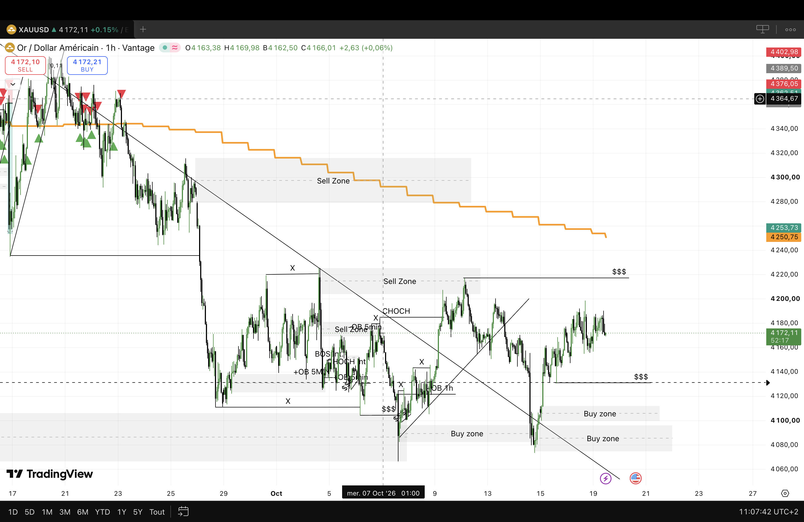
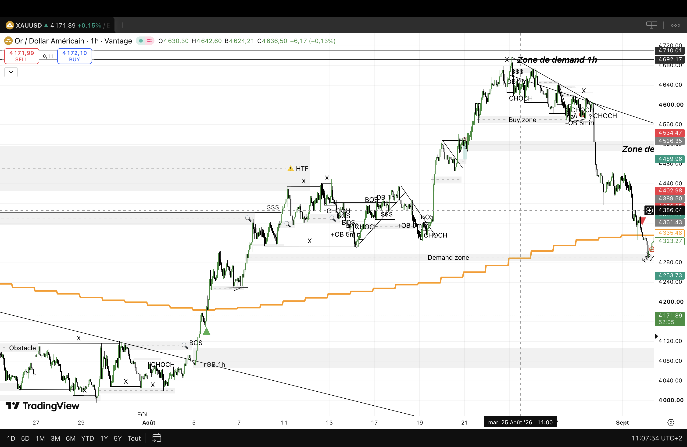
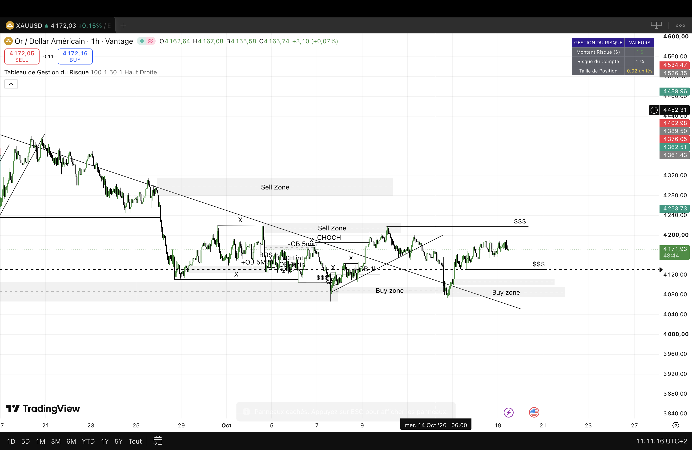
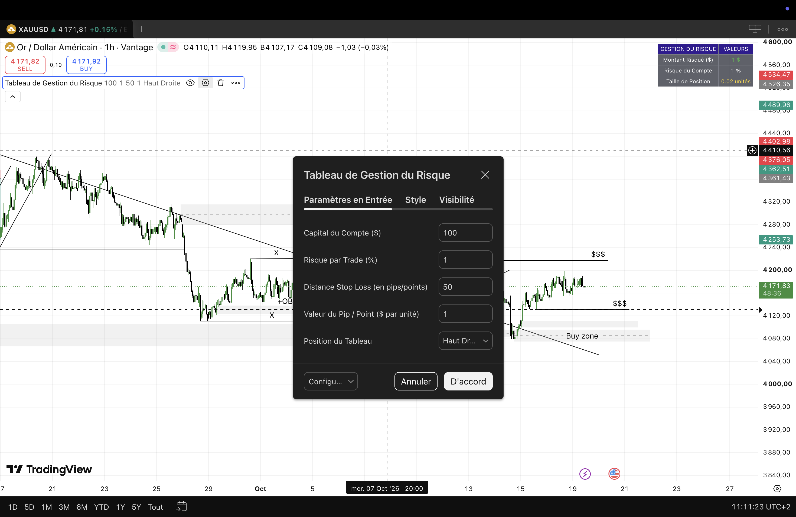

# 1.README INDICATEUR 1 : Multi-timeframe avec alertes (IMTA)

-----

# Multi-Timeframe Alert Indicator

Indicateur TradingView (Pine Script) qui compare [ex. : la tendance de plusieurs unités de temps] et déclenche des alertes configurables.

## Fonctionnalités

- Analyse sur [ex. : 3] unités de temps simultanées
- Alertes TradingView 
- Paramètres modifiables sans toucher au code

## Captures

| Paramètres | Alerte configurée |
|---|---|
|  |  |

## Installation

1. Ouvre un graphique sur TradingView, puis le **Pine Editor** (onglet en bas).
2. Copie le contenu de [`IMTA.pine`](IMTA.pine) et colle-le dans l'éditeur.
3. Clique sur **Enregistrer**, puis **Ajouter au graphique**.
4. Pour les alertes : clic droit sur le graphique, **Ajouter une alerte**, puis choisis l'indicateur dans la liste.

## Besoin d'une version sur mesure ?

Je peux adapter cet indicateur à ta méthode (autres conditions, alertes, tableau de bord). Contacte-moi : contact.emma.cpuops@gmail.com

> ⚠️ Outil technique à but éducatif, pas un conseil en investissement.

# 2. README INDICATEUR 2 : Tableau de gestion du risque

# Risk & Position Size Table

Indicateur TradingView (Pine Script) qui calcule la taille de position à partir de ton capital, du pourcentage de risque et de ton stop.

## Fonctionnalités

- Taille de position calculée automatiquement
- Risque exprimé en % du capital et en montant
- Ratio rendement/risque affiché pour ton objectif de prix

## Captures

| Paramètres | Alerte configurée |
|---|---|
|  |  |

## Exemple de calcul

| Donnée | Valeur |
|---|---|
| Capital | [ex. 10 000] |
| Risque par trade | [ex. 1 %] |
| Distance au stop | [ex. 50 points] |
| Taille de position | [résultat affiché par l'indicateur] |

## Installation

1. Ouvre un graphique sur TradingView, puis le **Pine Editor**.
2. Copie le contenu de [`TGR.pine`](TGR.pine) et colle-le dans l'éditeur.
3. Clique sur **Enregistrer**, puis **Ajouter au graphique**.
4. Renseigne ton capital, ton % de risque et ton stop dans les paramètres.

## Besoin d'une version sur mesure ?

Je peux l'adapter à ton instrument, à ton broker ou à tes règles de risque. Contacte-moi : contact.emma.cpuops@gmail.com

> ⚠️ Outil technique à but éducatif, pas un conseil en investissement.
